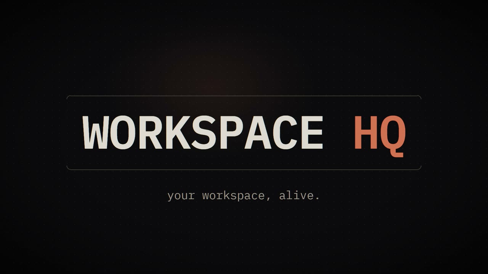

# WorkspaceHQ

A local desktop console for the code on one Windows machine. A scan reads every project folder (git
state, uncommitted and unpushed work, file and line counts, TODO/FIXME, secrets left in plain sight,
recent activity). An Electron app turns that into one screen: what changed since the last scan, the
next thing that needs you, and where the risks are. It has a light game layer on top: levels, XP and a
pixel mascot called Bit.

[](dashboard-v5/media/hq-trailer-1.webm)

▶ [Trailer (30 s)](dashboard-v5/media/hq-trailer-1.webm) · [Trailer 2, feature tour (61 s)](dashboard-v5/media/hq-trailer-2.webm)

> **The trailers show placeholder data.** The project names, numbers and the sample question are made
> up for the video. They are also **silent** for now: the soundtrack isn't in this repo yet. They were
> rendered from the Claude Design files with [`tools/trailer/`](tools/trailer/README.md).

## Status

- A personal tool, built for one machine. Windows only, no installer.
- v5 (`dashboard-v5/`, built from the Claude Design file) is live: the app loads it by default.
- The older renderers, v2 to v4, were removed on 2026-10-28. They live on in git under the tag
  `cleanup-base-2026-10-28`. `tools\rollback.ps1 v5` restarts the app; add `-DryRun` to see the plan first.
- The trailers stay silent until the soundtrack is muxed in.

## What's in the box

| folder | what |
|---|---|
| `collector/` | The scan. Plain Node + git over the local filesystem, no prompts. An optional enrichment step asks the `claude` CLI for the soft fields (completion %, risk, insights). It is skipped when the CLI isn't installed. |
| `dashboard/` | The Electron app (Electron 32): main process, tray, the quick-run global hotkey, and the IPC every renderer uses. |
| `dashboard-v5/` | The renderer. Vanilla JS, no framework, no build step. |
| `mcp/workspacehq/` | The `workspacehq` MCP server that Claude Code sessions bind through `.mcp.json` ([tools](mcp/workspacehq/README.md)). |
| `browser-bridge/` | Browser extension. It reports the active tab to the app. Its read-only scrape also uses your logged-in sessions on Bluesky, Mastodon, Reddit, X, LinkedIn, Instagram, Threads, Facebook and YouTube to write your feeds, mentions, notifications and post stats to `data/social/*.json` — currently nothing reads those files: the Social tab and the MCP read tools went in the 2026-10-28 cleanup (see below). It publishes a post that Claude staged only when you press approve & send ([how approval works](browser-bridge/README.md)). |
| `schema/`, `spellbook/` | Scan data schema; curated automation ("spell") definitions. |
| `tools/trailer/` | Renders the two trailers to video. |
| `docs/` | Data contract (`docs/sync/CONTRACT.md`), IPC contract, design notes. |

In the app: Home (changes since the last scan, the next action, Scan now), Projects (grid, map,
project pages, and a commit sheet that refuses to commit `.env` files; it doesn't scan file contents
for keys), Tasks, Automations, Claude sessions, History, System and Life.

In v5, Ask answers questions from your scan data with a local model (Ollama or LM Studio, on
localhost).

One global hotkey: `Ctrl+Alt+X` (quick-run). The summon, snip, recorder and Studio hotkeys went
with their features on 2026-10-28.

## Run it (PowerShell)

Every command here runs from the repo root.

```powershell
Push-Location dashboard
npm install
node_modules\electron\dist\electron.exe .
Pop-Location
```

Get some data in: choose which folders to scan in `collector/collector.config.json`, then run the scan
without the LLM step and rebuild the renderer data:

```powershell
node collector/collector.mjs
node collector/assemble.mjs
node dashboard/build-data.mjs
```

The full pipeline (collector → optional enrichment → assemble → render) is `.\run-pipeline.ps1`.
Add `-NoEnrich` to stay offline, and `-ReportsDir <folder>` to choose where scan history is written.

The app runs v5, the only renderer. `tools\rollback.ps1 v5` writes `data/.ui-version` (gitignored)
and restarts the app.

Tests (Node 25; the Claude Hub tests need Node 22.13 or newer for `node:sqlite`):

```powershell
node --test dashboard/*.test.mjs
node --test dashboard/claude-hub/*.test.mjs
node --test dashboard/money/*.test.mjs
node --test dashboard/cosmos/*.test.mjs
node --test dashboard-v5/src/*.test.mjs dashboard-v5/src/dc/*.test.mjs dashboard-v5/src/live/*.test.mjs dashboard-v5/src/logic/*.test.mjs dashboard-v5/src/elements/*.test.mjs dashboard-v5/src/vals/*.test.mjs dashboard-v5/styles/*.test.mjs dashboard-v5/tools/*.test.mjs
node --test tools/*.test.mjs tools/trailer/*.test.mjs mcp/workspacehq/*.test.mjs
```

The Cosmos thumbnail check runs in a real, hidden Electron instance (own temporary profile, never the app). It makes its own
test pictures at run time, proves the colours are not blue-shifted for each decode path (the Windows shell, nativeImage, and the
hidden Chromium window, which also proves the SVG route is not a tainted canvas), that the decode window cannot reach the network,
and that 20 large pictures never block the main loop for more than 750 ms. Exit 0 = clean, 1 = a case failed, 2 = timed out (60 s).
`HQ_COSMOS_CHECK_BREAK=bgr` turns the BGRA to RGBA swap off on purpose and must exit 1. `--avif=<file>` supplies a tiny AVIF to
decode. `--dry-run=<folder>` runs INSTEAD of the cases: it walks that folder read-only and prints only `ext ok failed` counts, never a name:

```powershell
dashboard\node_modules\electron\dist\electron.exe dashboard\cosmos-native.check.js
dashboard\node_modules\electron\dist\electron.exe dashboard\cosmos-native.check.js --dry-run=<folder>
```

The client site check (project page, under the delivery card) has the same kind of real-Electron check. It serves a placeholder site (en / fr / ar pages with deliberate faults: a wide table, a missing viewport tag, tiny text, a small button, a page with no direction, a number run inside Arabic, a French page copied from English, requests to outside hosts, a WebRTC attempt) on 127.0.0.1 and runs the real check window against it, with a loopback listener standing in for the black-hole proxy. It asserts every seeded fault is found, the blocked count equals the fixture's outside references, and no outside request succeeded, and it prints how many connections the canary saw from traffic the request hook cannot see. Exit 0 = clean, 1 = a case failed, 2 = timed out. `HQ_DCK_CHECK_BREAK=hook` points the run at a port nothing listens on and must exit 1 (it proves the check can fail):

```powershell
dashboard\node_modules\electron\dist\electron.exe dashboard\delivery-check.native.check.js
```

The Claude library scenarios run against the v5 harness with the fake preload (from `dashboard-v5`, own `HQ_V5_PROFILE`):

```powershell
..\dashboard\node_modules\electron\dist\electron.exe dev-main.js --preload=fake --hidden --remote-debugging-port=9351
node tools/cdp-gate.mjs --port 9351 --scenario claude-library-search,claude-thread-open
```

The in-app chat (Claude Hub H3) runs against a fake `claude`, never real quota:

```powershell
node --test dashboard/claude-chat.test.mjs dashboard/claude-chat.e2e.test.mjs dashboard/stream-parse.test.mjs
node dashboard-v5/tools/cdp-gate.mjs --port <port> --scenario claude-chat-stream-stop,claude-chat-mode-readonly   # against dev-main.js --preload=fake
```

The Hub also indexes your Claude memory notes, CLAUDE.md files, `~/.claude/history.jsonl` and the prompt notes in `VEEMO CORTEX/40_Resources/Prompts` — all on this PC, masked, read-only on every source. Search shows matching notes with a source badge.

Your claude.ai chats arrive live through the browser extension (0.6.0): press **Sync claude.ai** in its popup, keep a logged-in claude.ai tab open, and new or changed chats land in Claude › Chats every 5 minutes (read-only, details in [browser-bridge/README.md](browser-bridge/README.md)).

The data-export importers (claude.ai, ChatGPT, Instagram / Facebook ZIPs, the drop folder), the prompt library (Prompts, Candidates, runs, packs), Studio (snips, screen recordings), the Summon palette, and the Social tab with its MCP read tools (`hq_social_status/feed/mentions/metrics`) were removed on 2026-10-28; restore them from the git tag `cleanup-base-2026-10-28`.

Test overrides: `HQ_CLAUDE_BIN` is the absolute path of the `claude` the in-app chat runs (tests and gates point it at the `dashboard/__fixtures__` fake via `make-fake-claude.mjs`; never spend real quota in a test).

## Working on it

Two Claude Code sessions share this repo, split into lanes: frontend and structure. Read `CLAUDE.md`
and the top entry of `docs/sync/HANDOFF.md` before changing anything. Changes to the data shape go
through `docs/sync/CONTRACT.md` first.
