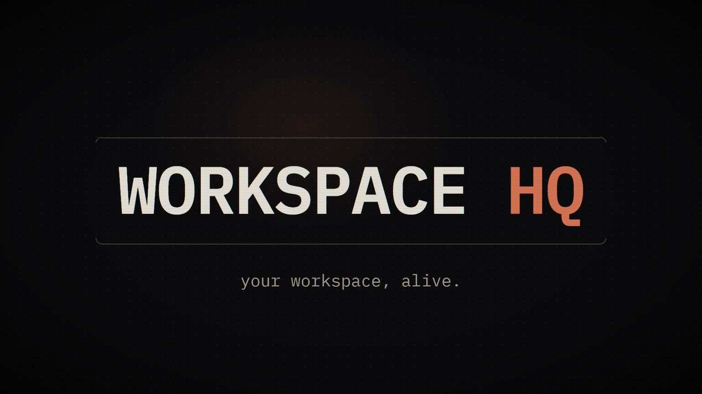

# WorkspaceHQ

A local desktop console for the code on one Windows machine. A scan reads every project folder (git
state, uncommitted and unpushed work, file and line counts, TODO/FIXME, secrets left in plain sight,
recent activity). An Electron app turns that into one screen: what changed since the last scan, the
next thing that needs you, and where the risks are. It has a light game layer on top: levels, XP and a
pixel mascot called Bit.

[](dashboard-v5/media/hq-trailer-1.webm)

▶ [Trailer (30 s)](dashboard-v5/media/hq-trailer-1.webm) · [Trailer 2, feature tour (61 s)](dashboard-v5/media/hq-trailer-2.webm)

> **The trailers show placeholder data.** The project names, numbers and the sample question are made
> up for the video. They are also **silent** for now: the soundtrack isn't in this repo yet. They were
> rendered from the Claude Design files with [`tools/trailer/`](tools/trailer/README.md).

## Status

- A personal tool, built for one machine. Windows only, no installer.
- v5 (`dashboard-v5/`, built from the Claude Design file) is live: the app loads it by default.
- The older renderers, v2 to v4, were removed on 2026-10-28. They live on in git under the tag
  `cleanup-base-2026-10-28`. `tools\rollback.ps1 v5` restarts the app; add `-DryRun` to see the plan first.
- The trailers stay silent until the soundtrack is muxed in.

## What's in the box

| folder | what |
|---|---|
| `collector/` | The scan. Plain Node + git over the local filesystem, no prompts. An optional enrichment step asks the `claude` CLI for the soft fields (completion %, risk, insights). It is skipped when the CLI isn't installed. |
| `dashboard/` | The Electron app (Electron 32): main process, tray, global hotkeys, and the IPC every renderer uses. |
| `dashboard-v5/` | The renderer. Vanilla JS, no framework, no build step. |
| `mcp/workspacehq/` | The `workspacehq` MCP server that Claude Code sessions bind through `.mcp.json` ([tools](mcp/workspacehq/README.md)). |
| `browser-bridge/` | Browser extension. It reports the active tab to the app. It also uses your logged-in sessions on Bluesky, Mastodon, Reddit, X, LinkedIn, Instagram, Threads, Facebook and YouTube to read your feeds, mentions, notifications and post stats into the app. It publishes a post that Claude staged only when you press approve & send ([how approval works](browser-bridge/README.md)). |
| `schema/`, `spellbook/` | Scan data schema; curated automation ("spell") definitions. |
| `tools/trailer/` | Renders the two trailers to video. |
| `docs/` | Data contract (`docs/sync/CONTRACT.md`), IPC contract, design notes. |

In the app: Home (changes since the last scan, the next action, Scan now), Projects (grid, map,
project pages, and a commit sheet that refuses to commit `.env` files; it doesn't scan file contents
for keys), Tasks, Automations, Claude sessions, History, System, Life and Studio (snips, screen
recordings).

In v5, Ask answers questions from your scan data with a local model (Ollama or LM Studio, on
localhost).

Global hotkeys:

| keys | what |
|---|---|
| `Ctrl+Alt+G` | summon |
| `Ctrl+Alt+X` | quick-run |
| `Ctrl+Alt+S` / `Ctrl+Alt+Shift+S` | snip |
| `Ctrl+Alt+R` / `Ctrl+Alt+Shift+R` | open or close the recorder panel (press Rec there to record) · stop a running recording |
| `Ctrl+Alt+L` | Studio |

## Run it (PowerShell)

Every command here runs from the repo root.

```powershell
Push-Location dashboard
npm install
node_modules\electron\dist\electron.exe .
Pop-Location
```

Get some data in: choose which folders to scan in `collector/collector.config.json`, then run the scan
without the LLM step and rebuild the renderer data:

```powershell
node collector/collector.mjs
node collector/assemble.mjs
node dashboard/build-data.mjs
```

The full pipeline (collector → optional enrichment → assemble → render) is `.\run-pipeline.ps1`.
Add `-NoEnrich` to stay offline, and `-ReportsDir <folder>` to choose where scan history is written.

The app runs v5, the only renderer. `tools\rollback.ps1 v5` writes `data/.ui-version` (gitignored)
and restarts the app.

Tests (Node 25; the Claude Hub tests need Node 22.13 or newer for `node:sqlite`):

```powershell
node --test dashboard/*.test.mjs
node --test dashboard/claude-hub/*.test.mjs
node --test dashboard-v5/src/*.test.mjs dashboard-v5/src/dc/*.test.mjs dashboard-v5/src/live/*.test.mjs dashboard-v5/src/logic/*.test.mjs dashboard-v5/src/elements/*.test.mjs dashboard-v5/styles/*.test.mjs dashboard-v5/tools/*.test.mjs
node --test tools/*.test.mjs tools/trailer/*.test.mjs mcp/workspacehq/*.test.mjs
# H6 archive sources only: node --test dashboard/claude-hub/ingest-chatgpt.test.mjs dashboard/claude-hub/ingest-docs.test.mjs dashboard/claude-imports.test.mjs dashboard/claude-import.test.mjs
# P1 prompt library only: node --test dashboard/claude-prompt-note.test.mjs dashboard/claude-prompts.test.mjs dashboard-v5/src/logic/prompts.test.mjs
# P2 prompt harvest only: node --test dashboard/claude-hub/harvest.test.mjs   (CDP scenarios prompts-promote-confirm, prompts-candidates-hide, against dev-main.js --preload=fake)
# P3 prompt run + packs only: node --test dashboard/claude-prompt-pack.test.mjs   (CDP scenarios prompts-run-chat, prompts-run-copy, prompts-pack-import, against dev-main.js --preload=fake)
```

The Claude library scenarios run against the v5 harness with the fake preload (from `dashboard-v5`, own `HQ_V5_PROFILE`):

```powershell
..\dashboard\node_modules\electron\dist\electron.exe dev-main.js --preload=fake --hidden --remote-debugging-port=9351
node tools/cdp-gate.mjs --port 9351 --scenario claude-library-search,claude-thread-open
```

The in-app chat (Claude Hub H3) runs against a fake `claude`, never real quota:

```powershell
node --test dashboard/claude-chat.test.mjs dashboard/claude-chat.e2e.test.mjs dashboard/stream-parse.test.mjs
node dashboard-v5/tools/cdp-gate.mjs --port <port> --scenario claude-chat-stream-stop,claude-chat-mode-readonly   # against dev-main.js --preload=fake
```

claude.ai import and extension sync (Claude Hub H4):

```powershell
node --test dashboard/claude-hub/unzip.test.mjs dashboard/claude-hub/parse-web.test.mjs dashboard/claude-hub/ingest-web.test.mjs
node --test dashboard/claude-import.test.mjs dashboard/claude-bridge-routes.test.mjs dashboard/claude-sync-ext.test.mjs
node dashboard-v5/tools/cdp-gate.mjs --port <port> --scenario claude-import-progress   # against dev-main.js --preload=fake
```

The Hub also indexes ChatGPT data exports (Claude › Chats › Import ChatGPT export, or drop the ZIP in `Documents\WorkspaceHQ Imports` and confirm the card once), your Claude memory notes, CLAUDE.md files, `~/.claude/history.jsonl` and the prompt notes in `VEEMO CORTEX/40_Resources/Prompts` — all on this PC, masked, read-only on every source. Search shows matching notes with a source badge.

Claude › Prompts is your prompt library: the notes in `VEEMO CORTEX/40_Resources/Prompts` (the vault is the source of truth — edit them in Obsidian), with tags, `{{variables}}`, how often each was run and when, search, and Open in Obsidian / Open file. Run opens the run box (below). Until you create the folder the Library says so.

Claude › Prompts › Candidates lists prompts you typed more than once or that started long sessions — harvested from your Claude Code, claude.ai and ChatGPT chats and your Claude Code prompt history. Each score is shown as its parts ("used in 3 sessions +9", "followed by 12 assistant messages +3", "already a prompt note −5"), never as a rating. Promote (one or several, after one confirm) writes a new note into `40_Resources/Prompts` — masked, never over an existing note; a name clash asks before saving as `-2`. Hide removes a candidate for good.

Run a prompt: Claude › Prompts › Run (or a project page's "Run a prompt") opens a run box — pick the project (it fills `{{project}}` and `{{cwd}}`), fill the other `{{fields}}`, then choose **Chat** (in-app Claude Code chat, read-only unless you allow edits — uses your Claude quota), **Terminal** (opens Claude Code in the project folder — uses your Claude quota), **Copy for claude.ai** or **Copy for ChatGPT** (copies the prompt and opens claude.ai/new or chatgpt.com — nothing else is ever opened). Each successful run adds one to that prompt's usage count in the Library. **Import pack** (a ZIP or a folder of `.md` notes) shows what it will copy and asks once — notes already in the Prompts folder are kept, never replaced; **Export pack** saves the Prompts folder as a ZIP and never overwrites a file.

Test overrides: `HQ_CLAUDE_BIN` is the absolute path of the `claude` the in-app chat runs (tests and gates point it at the `dashboard/__fixtures__` fake via `make-fake-claude.mjs`; never spend real quota in a test). `HQ_CLAUDE_IMPORT_ZIP` is the absolute path of a claude.ai export used instead of the file dialog (gates and second instances only).

## Working on it

Two Claude Code sessions share this repo, split into lanes: frontend and structure. Read `CLAUDE.md`
and the top entry of `docs/sync/HANDOFF.md` before changing anything. Changes to the data shape go
through `docs/sync/CONTRACT.md` first.
